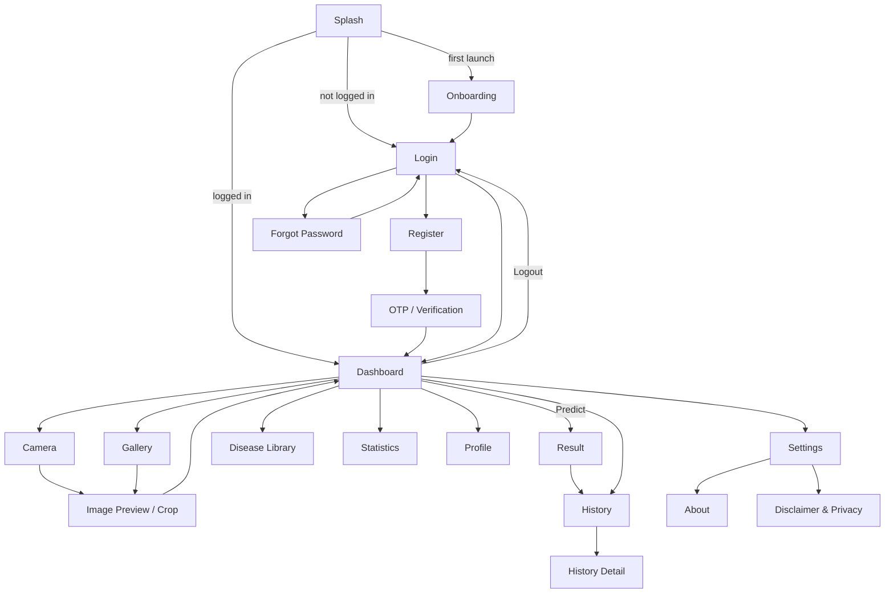

# UI / UX Design Specification
## Eye Disease Detection App (Android, Java + XML)

This document defines the look, feel and behaviour of every screen so the app feels **calm, trustworthy and medical-grade**, while staying simple for non-technical users.

---

## 1. Design Principles

1. **Trust first:** clean layouts, soft colours, honest wording, a disclaimer where it matters.
2. **One main action per screen:** each screen has one clear primary button.
3. **Plain language:** "Please upload a clear retina image", not technical errors.
4. **Never mislead:** low-confidence or non-retina images are rejected politely instead of showing a scary result.
5. **Fast feedback:** every action shows a loader, success or error state within 100 ms.
6. **Accessible:** large touch targets, good contrast, works with big fonts and TalkBack.
7. **Consistent:** same spacing, colours, components and wording everywhere.

---

## 2. Brand and Design Tokens

### 2.1 Colours (`res/values/colors.xml`)

| Token | Light | Dark | Use |
|---|---|---|---|
| `primary` | `#1E5AA8` | `#8AB4F8` | Main buttons, app bar, links |
| `primary_dark` | `#154073` | `#5C8FD6` | Status bar, pressed states |
| `secondary` | `#14A098` | `#4FD1C5` | Accents, icons, progress |
| `background` | `#F7F9FC` | `#121417` | Screen background |
| `surface` | `#FFFFFF` | `#1E2227` | Cards, dialogs, inputs |
| `text_primary` | `#1B1F24` | `#E8EAED` | Headings, body |
| `text_secondary` | `#5F6B7A` | `#A9B1BC` | Captions, hints |
| `divider` | `#E3E8EF` | `#2C323A` | Borders, dividers |
| `success` | `#2E7D32` | `#81C995` | Normal result, success |
| `warning` | `#B7791F` | `#F6C26B` | Low confidence notes |
| `error` | `#C62828` | `#F28B82` | Errors, delete |

### 2.2 Result Colours (badges only, not full-screen colour)

| Class | Colour | Icon idea |
|---|---|---|
| Normal | `#2E7D32` (green) | check-circle |
| Cataract | `#B7791F` (amber) | eye with cloud |
| Glaucoma | `#D9480F` (orange) | eye with ring |
| Diabetic Retinopathy | `#C62828` (red) | eye with dots |
| Not a retina image | `#5F6B7A` (grey) | image-off |

> Colour is never the only signal: always show the text label too (colour-blind users).

### 2.3 Typography (Material, Roboto; optional Poppins for headings)

| Style | Size | Weight | Use |
|---|---|---|---|
| Display | 28sp | Bold | Splash app name |
| Headline | 24sp | Bold | Screen titles, result class |
| Title | 18sp | Medium | Card titles, section headers |
| Body | 16sp | Regular | Main text |
| Body small | 14sp | Regular | Secondary text |
| Caption | 12sp | Regular | Date/time, hints, disclaimer |
| Button | 16sp | Medium | All buttons |

Always use **sp** for text so it scales with the user's font settings.

### 2.4 Spacing, Shape and Elevation

- **Grid:** 4dp base. Common values: 8dp, 12dp, 16dp (screen padding), 24dp (section gap), 32dp.
- **Corner radius:** 12dp cards, 10dp inputs/buttons, 24dp image preview, 16dp dialogs.
- **Elevation:** cards 2dp, app bar 0–4dp, dialogs 8dp. In dark mode, rely on surface colour instead of shadow.
- **Touch targets:** at least **48dp × 48dp**.
- **Buttons:** height 52dp, full width on forms.

### 2.5 Iconography
Material Symbols (outlined), 24dp, tinted with `primary` or `text_secondary`. Every icon-only button has a `contentDescription`.

---

## 3. Components

| Component | Spec |
|---|---|
| **Primary button** | MaterialButton, filled `primary`, white text, 52dp height, 10dp radius |
| **Secondary button** | Outlined, `primary` stroke 1dp |
| **Text button** | For links: "Forgot Password?", "Register" |
| **Text input** | TextInputLayout (Outlined), start icon, end icon for password toggle, error text below |
| **Action card** | MaterialCardView 12dp radius, icon (40dp) + label, ripple, min 96dp height |
| **Result card** | Large class name, colour badge, confidence progress bar with % |
| **Probability bar** | LinearProgressIndicator per class, label left, % right |
| **Info section** | Expandable card: title + chevron; body text with bullet list |
| **History item** | 64dp thumbnail (8dp radius), class name, confidence, date/time, delete icon |
| **Dialog** | MaterialAlertDialog: title, message, Cancel + destructive action in `error` colour |
| **Snackbar** | Short feedback ("Record deleted" with **Undo**) |
| **Loader** | CircularProgressIndicator + short text ("Analysing image…") |
| **Empty state** | Illustration (120dp) + title + subtitle + action button |
| **Disclaimer bar** | Caption text with info icon, light `warning` background tint |

---

## 4. Navigation Map



---

## 5. Screen Specifications

Each screen lists layout, states and key UX rules. Wireframes are simplified.

### 5.1 Splash
```
┌──────────────────────────┐
│                          │
│          (eye)           │  logo 96dp, fade + scale-in 400ms
│   Eye Disease Detection  │  Display 28sp, primary
│  AI screening for retina │  Body small, text_secondary
│                          │
│           ◌              │  small progress
└──────────────────────────┘
```
- Background: `background` (or soft primary gradient).
- Duration: only while startup work runs (min 1 s, max 2 s, Android SplashScreen API); no buttons.

### 5.2 Onboarding (3 slides)
1. **"Scan retina images"**: what the app does.
2. **"Use a clear fundus image"**: example of a good image vs. a wrong one (hand/selfie).
3. **"Get results & tips"**: confidence, prevention, history.
- Dots indicator; **Skip** (top right), **Next** / **Get Started** (bottom, primary).

### 5.3 Login
```
┌──────────────────────────┐
│ (eye) Welcome back        │ Headline
│ Login to continue         │ Body, secondary
│ [✉ Email              ]  │
│ [🔒 Password       👁 ]  │
│              Forgot Password? │ text button, right aligned
│ [        LOGIN         ]  │ primary
│ Don't have an account? Register │
└──────────────────────────┘
```
- Keyboard: email type for email, `actionDone` on password submits.
- Errors inline under the field ("Please enter a valid email").
- Button shows a loader inside while signing in; inputs disabled.

### 5.4 Register
Fields: Full name, Email, Password, Confirm password; checkbox "I agree to the Disclaimer & Privacy Policy" (link opens the text). Primary button **Create Account**. Password strength hint under the field.

### 5.5 OTP / Verification
```
┌──────────────────────────┐
│ Verify your account       │
│ We sent a code/link to    │
│ k***@gmail.com            │
│ [ ][ ][ ][ ][ ][ ]        │ 6 boxes (code mode), auto-advance
│ [        VERIFY        ]  │
│ Resend in 0:45            │ disabled until timer ends
└──────────────────────────┘
```
- **Link mode:** show "Open your email and tap the link, then press **I've verified**".
- Auto-focus first box; paste support for 6 digits.

### 5.6 Forgot Password
Email field + **Send Reset Link**; success state: "Check your email to reset your password" with a **Back to Login** button.

### 5.7 Dashboard
```
┌──────────────────────────┐
│ Eye Disease Detection  👤 │ app bar, profile icon
│ Hello, Khayyam 👋         │
│ ┌──────────────────────┐ │
│ │   Image preview      │ │ 24dp radius, dashed border when empty:
│ │ "No image selected"  │ │ "Take or choose a retina image"
│ └──────────────────────┘ │
│ [📷 Camera] [🖼 Gallery] │ action cards (2 columns)
│ [   🔍 PREDICT        ]  │ primary, full width, disabled until image
│ [🕘 History] [📚 Library]│
│ [📊 Stats ] [⚙ Settings] │
│ [⎋ Logout ]              │ outlined, error tint
└──────────────────────────┘
```
- Small **"Image tips"** link under the preview opens the image guide.
- Back press: "Press back again to exit" (Snackbar/Toast).

### 5.8 Image Preview / Crop
Full-width image, toolbar with **Rotate** and **Crop**, bottom buttons **Retake** (outlined) and **Use Image** (primary).

### 5.9 Result (most important screen)
```
┌──────────────────────────┐
│ ← Result                  │
│ ┌──────────────────────┐ │
│ │     analysed image   │ │
│ └──────────────────────┘ │
│  [● Glaucoma]             │ colour badge + Headline 24sp
│  Confidence  92.4%        │
│  ████████████████░░       │ progress bar
│ ── All probabilities ──   │
│  Glaucoma        92.4% ██ │
│  Normal           4.1% ▏  │
│  Cataract         2.0% ▏  │
│  Diabetic Ret.    1.3% ▏  │
│ ▸ About                   │ expandable info sections
│ ▸ Symptoms                │
│ ▸ Prevention              │
│ ▸ Treatment               │
│ ▸ When to see a doctor    │ highlighted
│ ⓘ This is not a medical diagnosis. Consult an eye specialist. │
│ [Share Report] [Scan Again]│
└──────────────────────────┘
```
**States**
- **Loading:** image + loader "Analysing image…" (inference is usually < 1 s; keep the loader at least 400 ms so it does not flicker).
- **Accepted:** as above; Snackbar "Saved to History".
- **Rejected (not_fundus / low confidence):**
  ```
  (image-off icon, grey)
  This doesn't look like a clear retina image
  Please upload a clear fundus (retina) photo.
  [See image tips]  [Try another image]
  ```
  Not saved to History. Do not show disease names prominently.
- **Error (model failed / corrupt image):** "Something went wrong while reading this image. Please try another one."

**UX rules**
- Confidence shown with 1 decimal place; never show "100%" (cap display at 99.9%).
- For **Normal**: positive tone ("No signs detected by the model"), plus regular checkup advice.
- For diseases: calm tone. "The model found signs that match Glaucoma." "When to see a doctor" opens expanded by default.

### 5.10 History
```
┌──────────────────────────┐
│ ← History        Clear All│
│ ┌──┐ Glaucoma      92.4% 🗑│
│ └──┘ 12 Oct 2026, 3:45 PM │
│ ┌──┐ Normal        97.1% 🗑│
│ └──┘ 10 Oct 2026, 11:02 AM│
└──────────────────────────┘
```
- Newest first; optional section headers ("Today", "Yesterday", "Earlier").
- Delete → dialog "Delete this record? This cannot be undone." → Snackbar "Record deleted" with **Undo** (5 s).
- Clear All → dialog in `error` colour.
- **Empty state:** illustration + "No scans yet" + **Start a scan** button.
- Optional: swipe-to-delete with the same confirmation.

### 5.11 History Detail
Same layout as Result (accepted state) + date/time at the top + **Share** and **Delete** in the app bar.

### 5.12 Profile
Avatar (96dp, tap to change), name (editable), email (read-only), **Change Password** card, **Logout** button.

### 5.13 Disease Library
Grid/list of 4 cards (icon, name, one-line summary). Detail page: About, Symptoms, Prevention, Treatment, When to see a doctor.

### 5.14 Statistics
Summary tiles (Total scans, Last scan), **pie chart** by class (result colours + labels), **bar chart** scans per month. Empty state if no data.

### 5.15 Settings
Sections: **Appearance** (Dark mode: System/Light/Dark), **Language** (English/اردو), **Notifications**, **Data** (Clear history), **About** (About app, Disclaimer & Privacy, Version).

### 5.16 About / Model Info
App icon, version, "Model: MobileNetV2 (TensorFlow Lite)", test accuracy, classes, developer name, university.

### 5.17 Logout Dialog
Title "Logout?", message "You will need to login again.", buttons **Cancel** / **Logout** (error colour).

---

## 6. Microcopy (Messages)

| Situation | Message |
|---|---|
| Empty field | "This field is required" |
| Invalid email | "Please enter a valid email address" |
| Short password | "Password must be at least 6 characters" |
| Passwords differ | "Passwords do not match" |
| Wrong login | "Email or password is incorrect" |
| Email not verified | "Please verify your email first. Resend link?" |
| No internet (auth) | "No internet connection. Please check and try again." |
| Camera denied | "Camera permission is needed to take a photo. You can allow it in Settings." |
| Rejected image | "This doesn't look like a clear retina image. Please upload a clear fundus photo." |
| Saved | "Saved to History" |
| Deleted | "Record deleted" (Undo) |
| Reset sent | "Password reset link sent to your email" |
| Disclaimer | "This app is a screening aid, not a medical diagnosis. Please consult an eye specialist." |

All strings live in `strings.xml` (and `values-ur/strings.xml` for Urdu).

---

## 7. Motion and Feedback

- Screen transitions: default Material slide/fade (250–300 ms).
- Splash logo: fade + scale 0.9 → 1.0 (400 ms).
- Result: confidence bar animates from 0 to value (600 ms, decelerate).
- Buttons: ripple; loading state replaces the label with a small spinner.
- Respect "Remove animations" (system setting): skip non-essential animations.

---

## 8. Accessibility

- Text contrast ≥ **4.5:1** (normal text), ≥ 3:1 (large text, icons).
- Touch targets ≥ **48dp**; spacing between targets ≥ 8dp.
- `contentDescription` on every image/icon button ("Open camera", "Delete record").
- Result announced to TalkBack: "Result: Glaucoma, confidence 92 percent".
- Supports font scaling up to 200% without clipping (use `wrap_content`, ScrollView on long screens).
- Colour never used alone to convey meaning.
- Logical focus order on forms; `imeOptions` for Next/Done.

---

## 9. Dark Mode

- Use `Theme.Material3.DayNight` with `values-night/colors.xml`.
- Avoid pure black: background `#121417`, surface `#1E2227`.
- Images keep their original colours; badges use the dark-mode tones.

---

## 10. Urdu / RTL Support (v1.1)

- `android:supportsRtl="true"`; use `start`/`end` instead of `left`/`right`.
- Urdu font with good Nastaliq/Naskh support (e.g. Noto Nastaliq Urdu or Noto Naskh Arabic) for Urdu strings.
- Numbers and percentages remain readable (e.g. 92.4%).
- Test long Urdu strings for overflow.

---

## 11. Responsive Layout

- Base design: 360 × 800 dp. Test on small (320dp width) and large (411dp+) phones.
- Use ConstraintLayout and ScrollView for forms; keyboard must not hide the primary button (`adjustResize`).
- Image preview keeps a 1:1 ratio, max height ~40% of the screen.
- Landscape: content scrolls; no fixed heights that clip.

---

## 12. UX Checklist (before release)

- [ ] Every screen has a clear title and one primary action
- [ ] Loading, empty, error and success states designed for all data screens
- [ ] Reject state on Result works for non-retina images
- [ ] Disclaimer visible on Register and Result
- [ ] All icons have content descriptions
- [ ] Works in dark mode and with large fonts
- [ ] No hard-coded strings in layouts
- [ ] Back navigation behaves as expected (no return to Splash or Dashboard after Logout)
