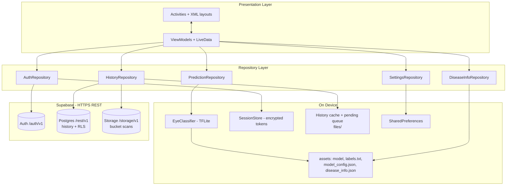
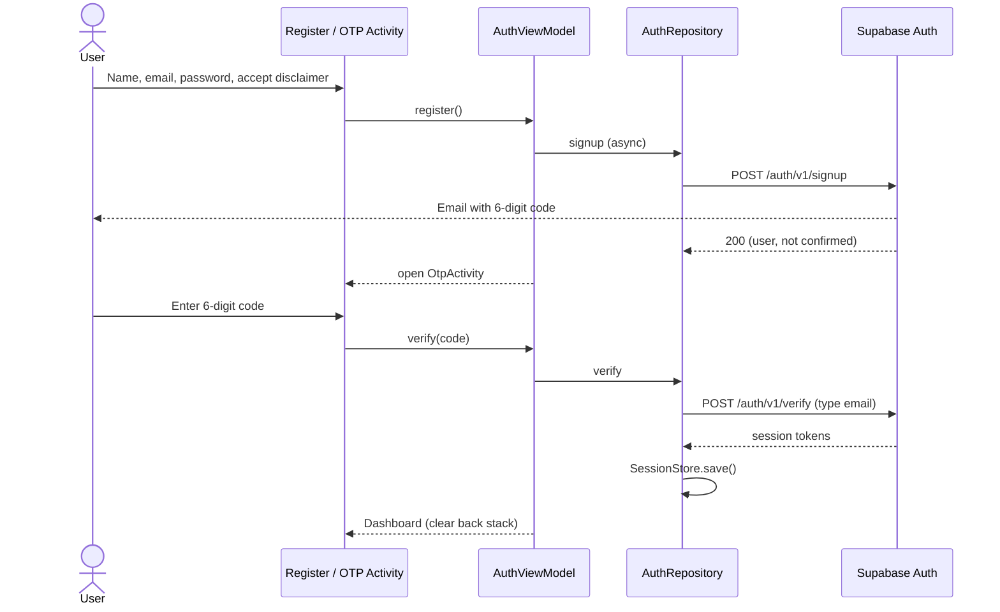
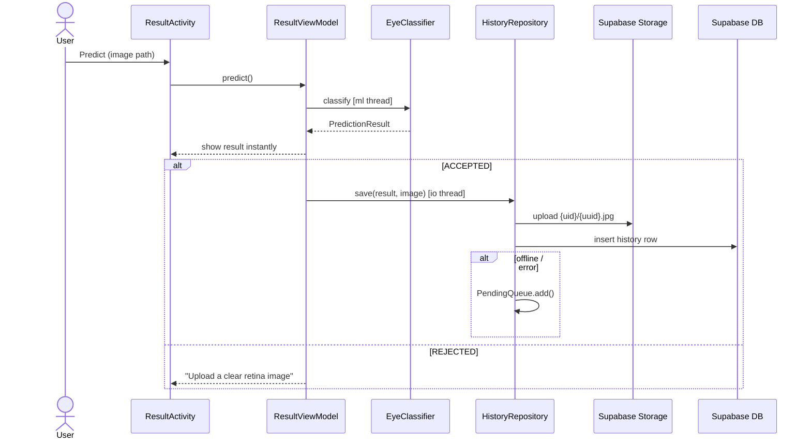

# Architecture Document
## Eye Disease Detection App (Android, Java + XML, Supabase)

Related documents: `PRD.md`, `UI_UX.md`, `Testing.md`.

---

## 1. Architecture Overview

The app uses **MVVM (Model–View–ViewModel)** with a **Repository** layer, written in **Java** with **XML** layouts. It is a multi-activity app; each module is one Activity with its own ViewModel.

- **View (Activity + XML):** shows state, forwards user actions. No business logic.
- **ViewModel:** holds screen state in `LiveData`, survives rotation, calls repositories.
- **Repository:** one per feature (auth, prediction, history, disease info, settings).
- **Data sources:**
  - **Supabase** (only backend): Auth, Postgres REST (`history` table), Storage (`scans` bucket), called with **Retrofit + OkHttp**.
  - **On device:** TFLite model + JSON files (assets), encrypted session store, History cache + pending upload queue (app private files), SharedPreferences (settings).



### 1.1 Key Decisions

| Decision | Choice | Reason |
|---|---|---|
| Language / UI | Java + XML | Project requirement |
| Pattern | MVVM + Repository | Separation, testability, rotation-safe |
| Backend | **Supabase only** (Auth, Postgres, Storage) | One backend; 6-digit email OTP built in |
| Supabase access | **REST APIs via Retrofit + OkHttp** | Official Android SDK is Kotlin and heavier; REST keeps APK small (20 MB rule) |
| Security | Anon key in app + **Row Level Security** | service_role key never in the app |
| ML inference | TensorFlow Lite on device | Offline, private, fast |
| Background work | `AppExecutors` (single-thread ML, IO pool) + Retrofit async | Simple threading in Java, no main-thread blocking |
| History speed / offline | Local cache (JSON) + pending upload queue | Cache-first UI, works offline, no Room |
| Backend setup | Supabase dashboard via **Claude in Chrome** | See `PRD.md` Section 14 |

---

## 2. Project Structure

```
app/
├── src/main/
│   ├── AndroidManifest.xml
│   ├── assets/
│   │   ├── eye_disease_model_fp16.tflite
│   │   ├── labels.txt
│   │   ├── model_config.json
│   │   └── disease_info.json
│   ├── java/com/khayyam/eyedisease/
│   │   ├── EyeApp.java                      # Application: lazy init, preload trigger
│   │   ├── ui/
│   │   │   ├── splash/      SplashActivity
│   │   │   ├── onboarding/  OnboardingActivity, OnboardingAdapter
│   │   │   ├── auth/        LoginActivity, RegisterActivity, OtpActivity,
│   │   │   │                ForgotPasswordActivity, AuthViewModel
│   │   │   ├── dashboard/   DashboardActivity, DashboardViewModel
│   │   │   ├── preview/     PreviewActivity
│   │   │   ├── result/      ResultActivity, ResultViewModel, ProbabilityAdapter
│   │   │   ├── history/     HistoryActivity, HistoryDetailActivity,
│   │   │   │                HistoryViewModel, HistoryAdapter
│   │   │   ├── library/     LibraryActivity, DiseaseDetailActivity
│   │   │   ├── stats/       StatisticsActivity, StatisticsViewModel
│   │   │   ├── profile/     ProfileActivity, ProfileViewModel
│   │   │   ├── settings/    SettingsActivity
│   │   │   ├── about/       AboutActivity, DisclaimerActivity
│   │   │   └── common/      UiState, Dialogs, ViewUtils
│   │   ├── data/
│   │   │   ├── remote/      SupabaseClient (Retrofit/OkHttp setup),
│   │   │   │                AuthApi, HistoryApi, StorageApi,
│   │   │   │                AuthInterceptor, TokenAuthenticator, dto/*
│   │   │   ├── auth/        AuthRepository, SessionStore
│   │   │   ├── history/     HistoryRepository, HistoryRecord,
│   │   │   │                HistoryCache, PendingQueue
│   │   │   ├── prediction/  PredictionRepository, PredictionResult
│   │   │   ├── disease/     DiseaseInfoRepository, DiseaseInfo
│   │   │   └── settings/    SettingsRepository
│   │   ├── ml/
│   │   │   ├── EyeClassifier.java           # TFLite load, warm-up, inference, reject rule
│   │   │   └── ModelConfig.java
│   │   └── util/
│   │       ├── AppExecutors.java            # ml (single), io (pool), main
│   │       ├── ImageUtils.java              # EXIF, downscale, compress, thumbnails
│   │       ├── ThumbnailCache.java          # LruCache + disk cache
│   │       ├── DateUtils.java
│   │       ├── NetworkUtils.java
│   │       └── PdfReportGenerator.java
│   └── res/  layout/, values/, values-night/, values-ur/, drawable/, xml/file_paths.xml
├── build.gradle
└── local.properties   # SUPABASE_URL, SUPABASE_ANON_KEY (not committed)
```

---

## 3. Modules → Components

| Module | Activity | ViewModel | Repository / Helper |
|---|---|---|---|
| M1 Splash | SplashActivity | (none) | AuthRepository (session check/refresh), SettingsRepository |
| M2 Onboarding | OnboardingActivity | (none) | SettingsRepository |
| M3 Register | RegisterActivity | AuthViewModel | AuthRepository → `/auth/v1/signup` |
| M4 OTP | OtpActivity | AuthViewModel | AuthRepository → `/auth/v1/verify`, `/auth/v1/resend` |
| M5 Login | LoginActivity | AuthViewModel | AuthRepository → `/auth/v1/token?grant_type=password` |
| M6 Forgot Password | ForgotPasswordActivity | AuthViewModel | AuthRepository → `/recover`, `/verify` (recovery), `PUT /user` |
| M7 Dashboard | DashboardActivity | DashboardViewModel | AuthRepository (name) |
| M8 Image Capture | DashboardActivity (ActivityResult) | DashboardViewModel | ImageUtils |
| M9 Preview / Crop | PreviewActivity | (none) | ImageUtils |
| M10 Prediction & Result | ResultActivity | ResultViewModel | PredictionRepository → EyeClassifier; HistoryRepository (background save) |
| M11 Disease Info | ResultActivity / DiseaseDetailActivity | ResultViewModel | DiseaseInfoRepository |
| M12 History | HistoryActivity | HistoryViewModel | HistoryRepository (cache + `/rest/v1/history` + storage) |
| M13 History Detail | HistoryDetailActivity | HistoryViewModel | HistoryRepository, DiseaseInfoRepository |
| M14 Profile | ProfileActivity | ProfileViewModel | AuthRepository → `PUT /auth/v1/user` |
| M15 Library | LibraryActivity, DiseaseDetailActivity | (none) | DiseaseInfoRepository |
| M16 Statistics | StatisticsActivity | StatisticsViewModel | HistoryRepository |
| M17 PDF Report | Result / HistoryDetail | (shared) | PdfReportGenerator |
| M18 Settings | SettingsActivity | (none) | SettingsRepository, HistoryRepository (clear all) |
| M19 About | AboutActivity | (none) | ModelConfig |
| M20 Disclaimer | DisclaimerActivity / dialog | (none) | SettingsRepository |
| M21 Logout | DashboardActivity / ProfileActivity | DashboardViewModel | AuthRepository → `/auth/v1/logout`; clears SessionStore, cache, queue |

---

## 4. ML Component: `EyeClassifier`

### 4.1 Responsibilities
1. Load `eye_disease_model_fp16.tflite` **once** (memory-mapped) in the background after the first frame; singleton in `EyeApp`.
2. Read `labels.txt` and `model_config.json`.
3. **Warm-up:** run one dummy inference so the user's first prediction is fast.
4. Preprocess: decode with `inSampleSize` → fix EXIF → RGB → resize **224×224 bilinear** → float32 buffer with **raw 0–255** (no `/255`, no mean subtraction). Buffer reused.
5. Run inference (2–4 threads, XNNPACK default) → 5 probabilities.
6. **Reject rule:** top = `not_fundus` **or** top < `min_confidence` → `REJECTED`.
7. Return `PredictionResult`.

### 4.2 Model Contract

| Item | Value |
|---|---|
| Input | float32 `[1,224,224,3]`, RGB, 0–255 |
| Output | float32 `[1,5]` softmax |
| Labels | 0 cataract, 1 diabetic_retinopathy, 2 glaucoma, 3 normal, 4 not_fundus |
| Config | `min_confidence`, `labels`, `input_size` (`model_config.json`) |

### 4.3 PredictionResult

| Field | Type |
|---|---|
| status | `ACCEPTED` / `REJECTED` / `ERROR` |
| label | String (null if rejected) |
| confidence | float (0–1) |
| probabilities | `Map<String, Float>` |
| inferenceMs | long |

### 4.4 Threading
All interpreter calls go through `AppExecutors.ml()` (single thread; Interpreter is not thread-safe). Results are posted to LiveData.

---

## 5. Supabase Data Layer

### 5.1 Configuration
- `SUPABASE_URL` and `SUPABASE_ANON_KEY` in `local.properties` → exposed as `BuildConfig` fields (not committed to Git).
- **Never** put the `service_role` key in the app.
- Backend schema, RLS and bucket are created by the SQL script in **`PRD.md` Appendix A** (run via Claude in Chrome, `PRD.md` Section 14).

### 5.2 Database Schema

**Table `public.history`**

| Column | Type | Notes |
|---|---|---|
| id | bigint identity | Primary key |
| user_id | uuid | Default `auth.uid()`, FK → `auth.users`, cascade delete |
| predicted_label | text | cataract / diabetic_retinopathy / glaucoma / normal |
| confidence | real | 0–1 |
| probabilities | jsonb | All 5 class probabilities |
| image_path | text | Storage path `{user_id}/{uuid}.jpg` |
| created_at | timestamptz | Default `now()` |

Index: `(user_id, created_at desc)`.
**RLS:** select / insert / delete only where `auth.uid() = user_id`. No update policy.

**Storage bucket `scans`** (private, max 2 MB, `image/jpeg`): policies allow select / insert / delete only inside the folder named after the user's id.

User name: stored in Auth user metadata (`full_name`), no extra table.

### 5.3 REST Endpoints Used

All requests go to `SUPABASE_URL` with header `apikey: <anon key>`. Authenticated requests also send `Authorization: Bearer <access_token>`.

| Purpose | Method + Path | Body / Params |
|---|---|---|
| Register | `POST /auth/v1/signup` | email, password, `data.full_name` → Supabase emails a 6-digit code |
| Verify signup OTP | `POST /auth/v1/verify` | `type: "email"` (older docs: `signup`), email, token → session |
| Resend signup OTP | `POST /auth/v1/resend` | `type: "signup"`, email |
| Login | `POST /auth/v1/token?grant_type=password` | email, password → session |
| Refresh session | `POST /auth/v1/token?grant_type=refresh_token` | refresh_token → new session |
| Send reset OTP | `POST /auth/v1/recover` | email |
| Verify reset OTP | `POST /auth/v1/verify` | `type: "recovery"`, email, token → session |
| Set new password / name | `PUT /auth/v1/user` | `password` or `data.full_name` |
| Current user | `GET /auth/v1/user` | – |
| Logout | `POST /auth/v1/logout` | – |
| List history (paged) | `GET /rest/v1/history` | `select=*&order=created_at.desc&limit=30&offset=N` |
| Insert history | `POST /rest/v1/history` | row JSON; header `Prefer: return=representation` |
| Delete one | `DELETE /rest/v1/history?id=eq.{id}` | – |
| Delete all (user) | `DELETE /rest/v1/history?user_id=eq.{uid}` | RLS limits to own rows |
| Upload image | `POST /storage/v1/object/scans/{uid}/{uuid}.jpg` | JPEG bytes, `Content-Type: image/jpeg` |
| Download image | `GET /storage/v1/object/authenticated/scans/{path}` | – |
| Delete images | `DELETE /storage/v1/object/scans` | `prefixes: [paths]` |

**Session object** (from verify/login/refresh): `access_token`, `refresh_token`, `expires_in`, `user { id, email, user_metadata.full_name }`.

### 5.4 Networking Components
- **SupabaseClient:** one shared `OkHttpClient` (connection pool, HTTP/2, 15 s timeouts, small HTTP cache) and one `Retrofit` (Gson converter).
- **AuthInterceptor:** adds `apikey` and `Authorization` headers.
- **TokenAuthenticator:** on HTTP 401, refreshes the token once (synchronised), saves it, retries the request; if refresh fails → session cleared → Login.
- **Error mapping:** Supabase error codes/messages → friendly messages (invalid credentials, email not confirmed, invalid/expired OTP, user already registered, rate limit 429, network timeout).
- **Logging interceptor:** debug builds only.

### 5.5 SessionStore
Stores `access_token`, `refresh_token`, `expires_at`, `user_id`, `email`, `full_name` in Android Keystore-backed encrypted storage. Cleared on logout.

### 5.6 History Cache and Pending Queue
- **HistoryCache:** last loaded pages saved as JSON in `files/history_cache_{uid}.json`; shown instantly when History opens (cache-first), then refreshed from Supabase; shown read-only offline.
- **PendingQueue:** if an upload fails (offline/timeout), the record JSON + local image path is saved in `files/pending/`. The queue is flushed (image upload → row insert, in that order) on app start, History open and network-available callback. Retries with backoff; duplicates prevented by a client-generated `uuid` image name.
- **Local images:** compressed copies kept in `files/scans/{uid}/` so History/Detail can display without downloading; downloaded thumbnails cached by `ThumbnailCache`.

### 5.7 SharedPreferences (`SettingsRepository`)
`onboarding_done`, `disclaimer_accepted`, `theme_mode`, `language`, `notifications_enabled`.

### 5.8 Disease Info
`assets/disease_info.json` → per class: `title`, `about`, `symptoms[]`, `prevention[]`, `treatment[]`, `see_doctor`. Parsed once (background) and cached.

---

## 6. Key Flows

### 6.1 Register + OTP



### 6.2 Prediction + Background Save



### 6.3 History (cache-first)
Open → show `HistoryCache` + pending items immediately → fetch page 1 from `/rest/v1/history` → DiffUtil update → load next pages on scroll. Delete: remove from list instantly (Undo 5 s) → then delete row + image on server → on failure restore item and show message.

### 6.4 Forgot Password
Email → `POST /recover` → user enters code + new password → `POST /verify (recovery)` → session → `PUT /user {password}` → Dashboard.

### 6.5 Splash Routing
`onboarding_done == false` → Onboarding · session exists → refresh if expired → Dashboard (refresh fails → Login) · else → Login.

### 6.6 Logout
Confirm → `POST /auth/v1/logout` (fire-and-forget) → clear SessionStore, HistoryCache, PendingQueue for that user → Login with `FLAG_ACTIVITY_NEW_TASK | FLAG_ACTIVITY_CLEAR_TASK`.

---

## 7. Dependencies (names only; use latest stable versions)

| Purpose | Library |
|---|---|
| UI | `androidx.appcompat`, `com.google.android.material`, `androidx.constraintlayout`, `androidx.recyclerview`, `androidx.viewpager2`, `androidx.core:core-splashscreen` |
| Lifecycle | `androidx.lifecycle` (ViewModel, LiveData) |
| Network (Supabase) | `com.squareup.retrofit2:retrofit`, `converter-gson`, `com.squareup.okhttp3:okhttp` (+ `logging-interceptor` debug only) |
| Secure storage | `androidx.security:security-crypto` (or a Keystore-based equivalent) |
| ML | `org.tensorflow:tensorflow-lite` |
| Images | `androidx.exifinterface` |
| Startup | `androidx.profileinstaller` (Baseline Profile) |
| Charts (v1.1) | Lightweight chart library or custom views (within size budget) |
| Test only | JUnit, Mockito, OkHttp `mockwebserver`, Espresso, Macrobenchmark, LeakCanary (debug) |

**Not used:** Firebase, Room, Supabase Kotlin SDK, GPU delegate (size and simplicity).

**Gradle notes:** `androidResources { noCompress "tflite" }`, `minSdk 24`, R8 + `shrinkResources` in release, ABI filters `arm64-v8a`, `armeabi-v7a` (or AAB), `buildConfigField` for Supabase URL/key.

---

## 8. Permissions

| Permission | Why |
|---|---|
| `INTERNET` | Supabase |
| `ACCESS_NETWORK_STATE` | Offline detection, queue flush |
| `CAMERA` (runtime) | Take photo |
| `POST_NOTIFICATIONS` (API 33+, optional) | Checkup reminder |

`<uses-feature android:name="android.hardware.camera" android:required="false"/>`. Gallery via Photo Picker / `GetContent` (no storage permission).

---

## 9. Error Handling

| Error | Handling |
|---|---|
| No internet (auth) | Message / No Internet screen with Retry |
| No internet (save) | PendingQueue; "Will upload when online" |
| 401 expired token | TokenAuthenticator refresh + retry; else Login |
| 429 rate limit (OTP) | "Too many requests, please wait and try again"; resend cooldown |
| Invalid/expired OTP | Inline error under the code boxes |
| Email not confirmed | Offer resend code → OTP screen |
| Supabase 5xx / timeout | Friendly message + Retry; app keeps working offline for prediction |
| Model load failure | Error on Result + retry |
| Corrupt / huge image | Downscale on decode; catch exceptions |
| Permission denied | Explanation + Settings link |

---

## 10. Security and Privacy

- Only **anon key** in the app; all access controlled by **RLS** (table) and **storage policies** (bucket).
- `service_role` key never in the app, Git, or chat; rotate keys if exposed.
- HTTPS only (`usesCleartextTraffic=false`).
- Tokens in encrypted storage; cleared on logout.
- Images private (bucket not public); downloaded with the user's token.
- `allowBackup` disabled (or exclusions) for session/cache files.
- Release: R8 with keep rules for Retrofit/Gson DTOs and TFLite.
- Custom SMTP recommended for production; built-in email is for testing.

---

## 11. Performance Architecture (links to `PRD.md` Section 11)

| Technique | Where |
|---|---|
| Model preload + warm-up | `EyeApp` → `EyeClassifier` after first frame |
| Background executors | `AppExecutors` (ml single thread, io pool) |
| Async network | Retrofit `enqueue`, shared OkHttp client, HTTP/2, connection pool |
| Cache-first History | `HistoryCache` then network refresh |
| Background saving + queue | `HistoryRepository`, `PendingQueue` |
| Paged lists + DiffUtil | `HistoryAdapter` (`ListAdapter`), 30 per page |
| Thumbnail caching | `ThumbnailCache` (LruCache + disk), local image copies |
| Optimistic delete | `HistoryViewModel` |
| Fast startup | SplashScreen API, lazy init, Baseline Profile |
| Main-thread safety | StrictMode in debug |

---

## 12. Testability

- Repositories behind interfaces → fakes in ViewModel unit tests.
- Supabase APIs tested with OkHttp **MockWebServer** (JSON responses for success/errors).
- Integration tests against a **separate Supabase test project** (never the production project).
- `EyeClassifier` preprocessing is pure (bitmap → buffer) → unit-testable; inference tested on device.
- Espresso for UI flows. See `Testing.md`.

---

## 13. Future Extensions

- Grad-CAM heatmap on Result (model change).
- Remote model updates (download new `.tflite` from Supabase Storage).
- Supabase Edge Function for reports/analytics.
- Multi-language disease content.
